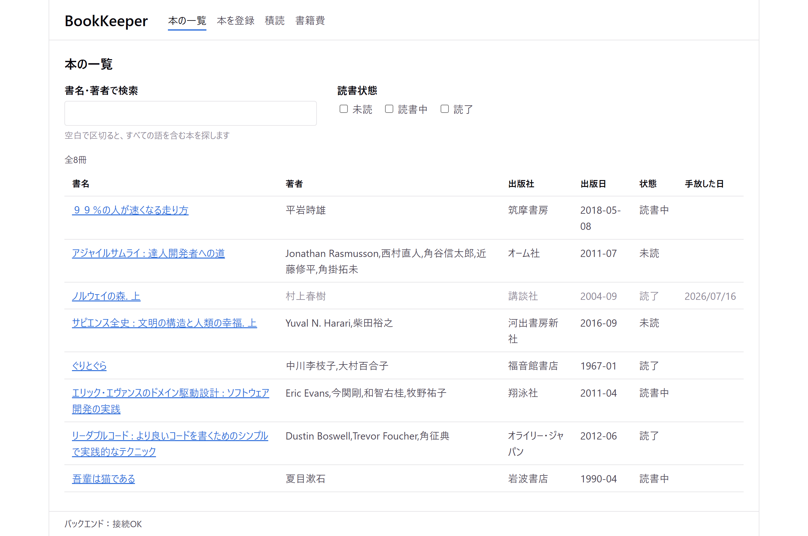
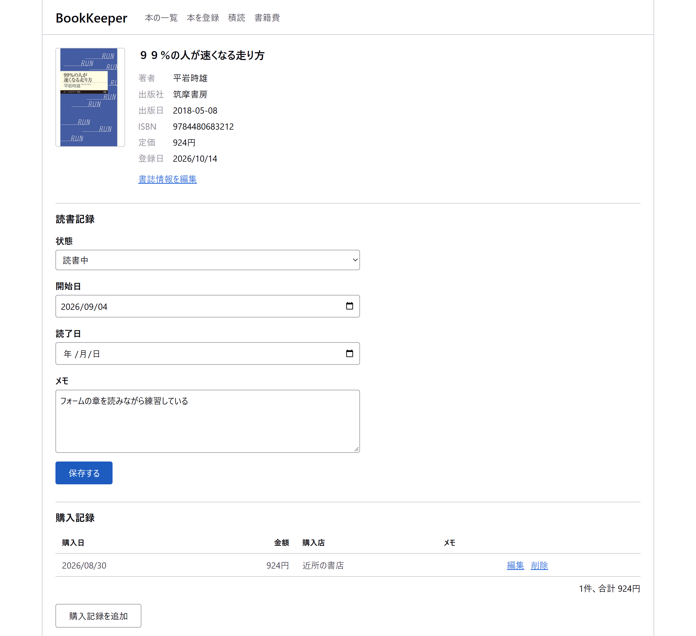
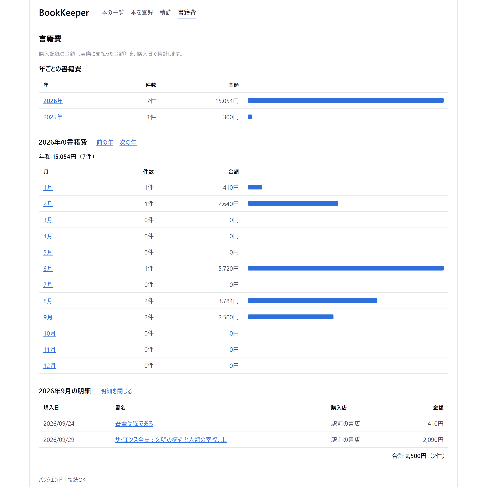

# BookKeeper

本を管理する目的＋「簿記・帳簿付け」という意味の英語"bookkeeping"から命名した。  
ISBN から書誌情報を取得できる、読書管理と書籍費の記録のための Web アプリ。
買った本・読んだ本・本に使ったお金を、1冊ごとにまとめて記録できる。

> ISBN（国際標準図書番号）は、本を1冊ずつ見分けるための番号。本の裏表紙やバーコードの近くに「ISBN978-4-00-310101-8」のような形で印刷されている。今は13桁で、2006年までに出た本には10桁のものもある。

ISBN からの書誌情報の取得以外の機能は、インターネットに接続しなくても使える。データは手元の SQLite のファイルに保存する。

MCP サーバーとして、Claude Code から自然言語でも操作できる（[AI から使う](#ai-から使うmcp-サーバー)）。

## 作った動機

自分は家計簿をつける習慣はないものの、支出管理の必要性は感じていた。ただ、いきなりすべての支出を管理しようとしても長続きしない。そこで、好きな読書の支出に絞って管理することから始めようと、このアプリを作った。

また、積読の本が何円分眠っているかを金額で示せば、読まずに置いている本を読むきっかけになると考えた。

## 主な機能

- **本の登録**：ISBN を入れると、書誌情報（書名・著者・出版社・出版日・定価・表紙）を [openBD](https://openbd.jp/) から取得して入力欄に入れる。ISBN を使わずに、手動でも書誌情報を入力できる
- **一覧と検索**：書名・著者のキーワードと、読書状態（未読・読書中・読了）で絞り込める。絞り込みの条件は URL に残る
- **読書記録**：状態・開始日・読了日・メモを1冊ごとに記録する
- **購入記録と書籍費の集計**：実際に払った金額を記録し、年ごと・月ごとに集計する。同じ本を何度か買った場合も記録できる
- **積読の一覧**：買ってまだ読み終えていない本を、長く積んでいる順に表示する
- **手放した本の記録**：売った・譲った本も、購入記録と読書記録を残したまま「手放した日」を記録できる
- **AI から使う**：MCP サーバーとして、Claude Code などの AI アプリから自然言語で本を探したり、書籍費を聞いたり、読書状態を変えたりできる（[AI から使う](#ai-から使うmcp-サーバー)）

## 画面

**本の一覧**



**本の詳細（読書記録・購入記録）**



**書籍費の集計**



## AI から使う（MCP サーバー）

BookKeeper のデータを、MCP（Model Context Protocol）で AI のアプリに公開している。Claude Code から、「積読の本を見せて」「今年いちばんお金を使った月に買った本は？」と聞いたり、「この本を今日読み終わった」と伝えたりできる。アプリ本体は AI に頼らず、ローカルで完結したまま動く。

### デモ

**積読を見る**：「積読の本を見せて」と頼むと、AI が積読の一覧のツールを呼び、長く積んでいる順に表で答える。読み取りのツールなので、許可を聞かれずに動く

https://github.com/user-attachments/assets/c83b710d-5f96-4ef3-a092-aeb4b8b4b085

**ツールを組み合わせる**：「今年いちばんお金を使った月に買った本は？」と頼むと、1 年分の書籍費のツールで月を選び、その月の明細のツールで本を答える

https://github.com/user-attachments/assets/b56a34c8-8e93-4b08-a8f5-85ab31cbf5b7

**読書状態を変える**：「ドメイン駆動設計を今日読み終わった」と伝えると、AI が本の ID と今日の日付を選んで読書状態のツールを呼ぶ。DB を変えるツールなので、実行の前に送る内容を見せて許可を聞かれる。許可すると読了に更新され、渡さなかった読み始めた日はもとの値のまま残る

https://github.com/user-attachments/assets/885cb789-7d79-48a2-b35a-f8e2253909f3

### ツール

読み取りのツールが 7 つ、書き込みのツールが 1 つ（読書状態の更新）ある。本の登録・削除や購入記録の追加は、MCP からはできず、画面から行う。一覧は [docs/mcp.md](docs/mcp.md#ツール) を参照。

### Claude Code で使う

1. BookKeeper を起動する（[Docker で起動する](#docker-で起動する)）。MCP サーバーは、起動中の backend のコンテナの中で動く
2. このリポジトリのフォルダで Claude Code を開く。[.mcp.json](.mcp.json) の `bookkeeper` サーバーを使ってよいか聞かれるので、許可する
3. 「BookKeeper につながっているか確かめて」と頼み、`ping` が通ることを確かめる

### ほかの AI アプリから使う

手元の PC で動く AI アプリなら、同じ起動コマンドを登録すれば使える見込みがあるが、動作を確かめたのは Claude Code だけ。登録のしかたと、対象外のアプリ（ブラウザ版の ChatGPT など）は [docs/mcp.md](docs/mcp.md) の「ホストごとの登録」を参照。

### AI を使わずに試す

[MCP Inspector](https://github.com/modelcontextprotocol/inspector) で、ツールの一覧や説明を見たり、ツールを直接呼んだりできる。[uv](https://docs.astral.sh/uv/) と Node.js が必要。リポジトリのルートで実行する。

```sh
npx @modelcontextprotocol/inspector@2.11.0 uv --directory backend run python -m app.mcp_server
```

### 許可と注意

- [.claude/settings.json](.claude/settings.json) で、読み取りのツールは聞かれずに使え、書き込みのツール（`update_reading_status`）は毎回許可を聞かれるようにしている
- AI にデータを変えてもらうときは、Claude Code を手動モードで使う。自動モードでも使えるが、シェルを使える AI は、MCP のツールを通らずに（シェルから直接）データを変えることがある
- 万一、意図しない変更があったときは、[DB のバックアップ](#db-のバックアップ)から戻せる

## 技術スタック

| 分類 | 使用技術 |
|---|---|
| バックエンド | Python 3.13 / FastAPI / SQLAlchemy 2 / Alembic / SQLite / httpx |
| フロントエンド | React 19 / TypeScript 6 / Vite 8 / React Router / CSS Modules / zod |
| AI 連携 | MCP（Model Context Protocol）/ MCP Python SDK |
| テスト | pytest / Vitest / Testing Library |
| 静的解析・整形 | Ruff / ESLint / Prettier / TypeScript（型チェック） |
| 環境 | Docker Compose / uv / npm |

- 外部の CSS フレームワーク・フォント・CDN は使わず、ローカルだけで完結させている
- データ取得のライブラリは使わず、`fetch` の薄いラッパーとカスタムフックで実装している

## 動作環境

| 起動方法 | 必要なもの |
|---|---|
| Docker で起動する（おすすめ） | Docker（Docker Compose v2 以上を含む） |
| Docker を使わずに起動する | [uv](https://docs.astral.sh/uv/)（Python 3.13 は uv が用意する）、Node.js 22.12 以上の偶数の版（22・24 など）と npm |

- ポート：8000（バックエンド）と 5173（フロントエンド）を使う
- インターネット接続：ISBN からの書誌情報の取得と、初回の準備（Docker イメージ・依存関係のダウンロード）にだけ使う。それ以外は接続しなくても使える
- 動作を確かめた環境：Windows 11 / Docker 29.8 / Docker Compose v5.6 / ブラウザは Chrome・Edge

## Docker で起動する

[Docker](https://www.docker.com/)（Docker Compose を含む）があれば、ほかに何も入れずに起動できる。コマンドは、リポジトリのルートで実行する。

- Docker を使わずに起動する場合は、[docs/development.md](docs/development.md) を参照
- 自分の PC で使うアプリとして作ったため、サーバーへの公開（デプロイ）や本番用のビルドの構成は用意していない

### 手順1：ポートが空いているか確かめる

ポート 8000（バックエンド）と 5173（フロントエンド）が使われていないことを確かめる。

```powershell
# Windows（PowerShell）。何も表示されなければ空いている
Get-NetTCPConnection -LocalPort 8000,5173 -State Listen -ErrorAction SilentlyContinue
```

```sh
# macOS・Linux など。何も表示されなければ空いている
lsof -nP -iTCP:8000 -iTCP:5173 -sTCP:LISTEN
```

使われていると、手順2で `ports are not available: exposing port TCP 127.0.0.1:8000 …` のようなエラーになり、起動しない。Windows の起動スクリプトは、この確認も自動で行う。

### 手順2：起動する

#### Windows：スクリプトで起動する

エクスプローラーで `start.cmd` をダブルクリックする。Docker Desktop の起動、BookKeeper の起動、DB のバックアップ、ブラウザで開くところまでを自動で行う。

ブラウザを指定するときは、PowerShell で `start.ps1` に `-Browser` を付けて実行する。指定しなければ、既定のブラウザで開く。

```powershell
.\start.ps1                    # 既定のブラウザで開く
.\start.ps1 -Browser msedge    # Edge で開く（chrome・firefox なども指定できる）
```

- `.ps1` の実行が禁止されている環境では、`powershell -ExecutionPolicy Bypass -File .\start.ps1 -Browser msedge` のように実行する。`start.cmd` は、この形で `start.ps1` を呼んでいる
- バックグラウンドで動かすので、ターミナルを閉じても止まらない。ログは `docker compose logs -f` で見られる

#### スクリプトを使わずに起動する

macOS・Linux の場合や、ログを見ながら動かしたい場合は、次のコマンドで起動する。

```sh
docker compose up --build
```

起動したら、http://localhost:5173 を開く。

#### 起動できたかの確かめ方

画面の下に「バックエンド：接続OK」と表示されれば起動できている。

- バックエンドは起動のたびに DB のテーブルを最新の状態にする（`alembic upgrade head`）。初回は空の DB が `backend/bookkeeper.db` にできる

### 手順3（任意）：サンプルのデータを入れる

本8冊と、その読書記録・購入記録を入れて試せる。起動したまま、ターミナルで実行する（`docker compose up` で起動した場合は、別のターミナルで実行する）。

```sh
docker compose exec backend uv run python -m app.sample_data
```

- 本が登録されている DB には入れない

### 止める

- スクリプトで起動した場合：`stop.cmd` をダブルクリックする（PowerShell では `.\stop.ps1`）。コンテナは消さずに残すので、次の起動が速い
- `docker compose up` で起動した場合：起動したターミナルで `Ctrl + C` を押す

どちらの方法で止めても、DB（`backend/bookkeeper.db`）は消えない。Docker Desktop は動いたままになるので、使わないときは Docker Desktop から終了する。

### DB のバックアップ

起動スクリプトは、起動のたびに DB の複製を `backend/backups/` に取る。新しいものから 10 個だけ残し、それより古いものは消す。ファイル名の時刻は UTC（例：`bookkeeper-20261101-050607Z.db`）。

スクリプトを使わずに起動した場合は、起動したまま、次のコマンドで取れる。

```sh
docker compose exec backend uv run python -m app.backup
```

- 誤って本を削除したときや、AI などのツールが意図しない変更をしたときに、元に戻すためのもの
- アプリが DB を使っている最中でも、SQLite のバックアップの機能で、壊れていない複製を取る

戻すときは、次の手順で行う。戻すと、バックアップを取ったあとの変更は消える。

1. BookKeeper を止める（上の「止める」を参照）
2. 念のため、今の `backend/bookkeeper.db` を別の名前でコピーしておく
3. 戻したいバックアップを `backend/bookkeeper.db` という名前で上書きコピーする
4. BookKeeper を起動する

### 補足

- ソースはコンテナにマウントしているので、コードを変えるとすぐ反映される
- `package.json` や `uv.lock` が変わったとき（git pull の後など）は、`docker compose up --build -V` で作り直す。`-V` は、コンテナ内の `node_modules` を入れ直すために付ける。起動スクリプトは `-V` を付けないので、このときは一度だけスクリプトを使わずに起動する

## 設計で工夫した点

### 外部 API のデータの揺れや接続できない場合の対応

openBD は本によって値の書き方が違う（著者名の形式、出版日の桁数、税込・税抜の表記など）。15冊分の ISBN で実際の応答を調べて変換の規則を決め、[docs/openbd.md](docs/openbd.md) にまとめた。

- 著者名は「姓, 名, (生年)」の形から、日本語なら「姓名(夏目漱石)」、欧米なら「名 姓(Dustin Boswell)」の形に整える
- 価格は ONIX の価格コードと値の中身から税込・税抜を判断し、税込の定価にそろえる
- openBD に接続できない・応答の形が違うときも、画面には「手動で入力してください」と伝え、手動での登録を続けられるようにした

### テーブル設計

設計の判断は [docs/db-design.md](docs/db-design.md) にまとめた。

- 書誌情報・読書記録・購入記録を分け、ISBN から取得し直しても自分の記録が消えないようにした
- 同じ本を何度か買う場合や、借りた本（購入記録なし）も扱えるよう、購入記録は本と 1:N にした
- 「削除」（登録ミスの取り消し）と「手放した日の記録」（売った・譲った）を分け、手放した本の支出も集計に残るようにした
- 金額は円単位の整数で保存し、小数の丸め誤差を避けた

### AI（MCP）向けの設計

設計の判断は [docs/mcp.md](docs/mcp.md) の「設計の判断のまとめ」にまとめた。

- 処理は API と MCP で共通のサービスにし、MCP のツールは薄い窓口にした
- AI はコードを見ず、説明だけでツールを選ぶ。ツールの説明文・引数・結果の項目の説明を AI 向けに書いた。検索は件数に上限を設け、当てはまった数を一緒に返して、AI が「残りがある」と気づけるようにした
- 失敗したときは、理由と次の手（「書名がわかれば検索して ID を調べる」など）を AI に返す
- 書き込みのツールは、変えてよい範囲を狭くした（読書のメモは変えない、省いた日付は今のまま）。ツールの注釈と許可のルールで、実行の前に必ず確認が入るようにした
- 試すうちに、シェルを使える AI は MCP のツールを通らずに DB を変えられるとわかった。道を塞ぐ対策は回り道が残るので、守りの中心を「起動のたびのバックアップ」にした

### API とエラーの扱い

- API のエラーは、ステータスコードによらず `{"detail": [{"type", "loc", "msg"}]}` の形にそろえた。画面はどのエラーでも同じ処理でメッセージを表示でき、入力エラーは該当する入力欄の横に出せる
- 入力エラーのメッセージは日本語にした（「書名を入力してください」など）
- ISBN は全角数字やハイフンを含んでもよく、ISBN-10 は ISBN-13 に変換し、チェックディジットで入力ミスを検出する（[docs/isbn.md](docs/isbn.md)）
- フロントエンドは API の応答を zod で検証し、バックエンドと形が食い違ったときに気づけるようにした

### 画面

- 検索語・絞り込み・表示する年月を URL に持たせ、再読み込みや「戻る」でも同じ表示に戻るようにした
- 入力欄とエラーメッセージを結びつけ、完了メッセージ・エラーを読み上げでも伝わるようにした

## テストと品質

- 新しい機能には必ずテストを書く方針で開発した（バックエンドは API ごと、フロントエンドは画面・部品ごと）
- 外部 API（openBD）はテストでモックに差し替える。差し替えを忘れて本物を呼ぶと、テストが失敗するようにしている
- コミットの前に、テスト・静的解析・型チェック・整形を通している

Docker で起動している間は、別のターミナルで次のように実行できる。

```sh
docker compose exec backend uv run pytest
docker compose exec frontend npm test -- --run
```

ホストで実行する方法は、[docs/development.md](docs/development.md) を参照。

## 開発の進め方

- 開発には Claude Code を使った。プロジェクトのルールを [CLAUDE.md](CLAUDE.md) にまとめ、実装の前に作業計画を出させて承認してから実装する、テストを必ず書かせる、などの進め方をとった
- 仕様や設計の判断は自分が行った
- 開発は小さな単位で進め、コミット前に自分でコードを読んだ。理解できない実装は、Claude Code に解説させた上でネット検索・書籍を使い間違いがないか調べた
- MCP サーバーは、初めて扱う技術だったので、ツールとテストを自分で書き、Claude Code にレビューさせる形で、実装を通して学んだ。学んだことと設計の判断は [docs/mcp.md](docs/mcp.md) にまとめた

## ドキュメント

| 文書 | 内容 |
|---|---|
| [docs/development.md](docs/development.md) | Docker を使わない開発環境、テスト・静的解析、データの保存場所とバックアップ |
| [docs/specification.md](docs/specification.md) | 書籍の登録・ISBN からの取得・書籍費・積読の細かい決まり |
| [docs/db-design.md](docs/db-design.md) | テーブル設計と、設計の判断の理由 |
| [docs/openbd.md](docs/openbd.md) | openBD の調査記録と、応答の変換の規則 |
| [docs/isbn.md](docs/isbn.md) | ISBN の扱いとチェックディジット |
| [docs/mcp.md](docs/mcp.md) | MCP サーバーの設計の判断と、実装しながら学んだこと |

## 今後やりたいこと

- 継続して使うモチベーションになるような要素が欠けていると感じている。読書量が可視化されるような仕組みを作りたい（Githubの草のようなイメージ）
- レシートの写真から購入日・金額・店名を読み取り、購入記録の下書きを作れるようにしたい。ISBN のない本は、表紙の写真から書名・著者を読み取りたい。読み取った結果は、利用者が確かめてから保存する
- 集計の数字と読書メモから、月ごとの読書と支出の振り返りを文章にしたい
- MCP からも本を登録できるようにしたい。AI が書誌情報や金額を間違えても気づけるよう、保存する前に利用者が確かめられる形を考えたい

## ライセンス

MIT License。[LICENSE](LICENSE) を参照。
